<div align="center">

# 🦅 Otonom İHA Takip, Kilitlenme ve Uçuş Kontrol Sistemi
### *Autonomous UAV Detection, Kalman Tracking, Target Lock-on & Flight Control HUD*

[](https://www.python.org/)
[](https://github.com/ultralytics/ultralytics)
[](https://pytorch.org/)
[](https://opencv.org/)
[](https://www.teknofest.org/)

<p align="center">
  <b>Hava muharebesi senaryolarında düşman/hedef İHA'ların gerçek zamanlı tespiti, Kalman filtresi destekli takibi, dinamik kilitlenme mekanizması ve otopilot için uçuş kontrol komutları (PWM) üreten uçtan uca otonom görev bilgisayarı yazılımı.</b>
</p>

---

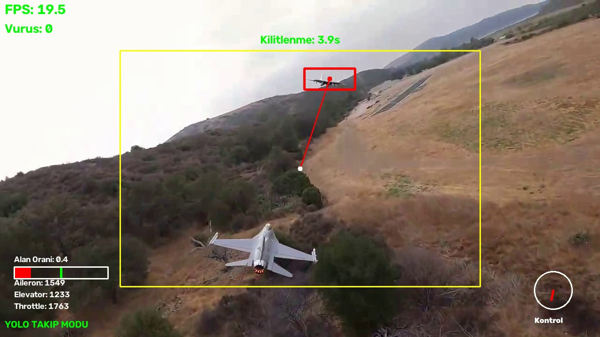
*Şekil 1: Canlı görev uçuşu sırasında kilitlenme geri sayımı, hedef merkezleme vektörü ve telemetri HUD göstergeleri.*

</div>

---

## 📌 İçindekiler
- [Proje Genel Bakışı](#-proje-genel-bakışı)
- [Önce / Sonra Karşılaştırması](#-önce--sonra-karşılaştırması)
- [Sistem Mimarisi ve Akış Şeması](#-sistem-mimarisi-ve-akış-şeması)
- [Temel Modüller ve Kod Analizi](#-temel-modüller-ve-kod-analizi)
  - [1. ROI Tabanlı Hızlı Tarama Modu](#1-roi-tabanlı-hızlı-tarama-modu-scan-mode)
  - [2. Kalman Filtresi ile Pürüzsüz Takip](#2-kalman-filtresi-ve-lokal-arama-tracking-mode)
  - [3. Kilitlenme ve Vuruş Mantığı](#3-kilitlenme-şartları-ve-vuruş-hit-mekanizması)
  - [4. Çift Kazançlı PID Gaz ve Sanal Otopilot PWM](#4-çift-kazançlı-pid-gaz-kontrolü-ve-vektörel-yönlendirme)
- [HUD (Head-Up Display) Göstergeleri](#-hud-head-up-display-göstergeleri)
- [Klasör ve Dosya Yapısı](#-klasör-ve-dosya-yapısı)
- [Kurulum ve Gereksinimler](#-kurulum-ve-gereksinimler)
- [Kullanım ve Komut Satırı Seçenekleri](#-kullanım-ve-komut-satırı-seçenekleri)
- [Test Sonuçları ve Başarım](#-test-sonuçları-ve-başarım)

---

## 🌟 Proje Genel Bakışı

Bu proje, özellikle **Teknofest Savaşan İHA (Hava-Hava Muharebesi)** yarışması standartları göz önünde bulundurularak geliştirilmiştir. Sistem, gövde üzerindeki kameradan alınan canlı video akışını işleyerek aşağıdaki görevleri **gerçek zamanlı (Real-Time)** olarak yürütür:

1. **Akıllı Tarama (ROI Scanning):** Hedef görüş alanında değilken tüm kare yerine ekranı 4 çeyreğe (Region of Interest) bölerek GPU yükünü optimize eder ve yüksek FPS'te arama yapar.
2. **Derin Öğrenme Tabanlı Tespit:** Özel eğitilmiş `YOLOv8s` ağırlıkları ile İHA'ları yüksek doğrulukla sınıflandırır ve konumlandırır.
3. **Kalman Filtreli Dinamik Takip:** Hızlı manevralarda, anlık parlamalarda veya kare kayıplarında hedefi kaçırmamak için 8 durumlu Doğrusal Kalman Filtresi (`cv2.KalmanFilter`) ve geçmiş sınırlayıcı kutu yumuşatması kullanır.
4. **Otonom Kilitlenme ve Vuruş Onayı:** Hedef, belirlenen merkezleme alanında minimum boyut kriterlerini sağlayarak **4 saniye** boyunca kalırsa başarılı kilitlenme (**VURUŞ**) tescil edilir.
5. **Otopilot Entegrasyonuna Hazır PWM Çıkışları:** Hedefin açısal ve boyutsal sapmalarına göre gerçek uçuş kontrolcülerine (Pixhawk / ArduPilot / iNav) iletilebilecek `1000 - 2000 µs` aralığında **Aileron**, **Elevator** ve PID kontrollü **Throttle (Gaz)** sinyalleri üretir.

---

## 🔄 Önce / Sonra Karşılaştırması

Aşağıda ham kamera görüntüsü ile sistemin ürettiği anlık telemetri ve HUD katmanının karşılaştırması görülmektedir:

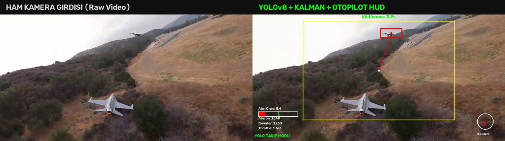
*Şekil 2: Ham video karesi (Sol) ile YOLOv8 tespiti, Kalman filtresi, hedef kilitlenme göstergesi ve uçuş telemetri HUD'ı (Sağ).*

---

## 🏗️ Sistem Mimarisi ve Akış Şeması

Sistemin döngüsel çalışma mantığı aşağıda şematize edilmiştir:

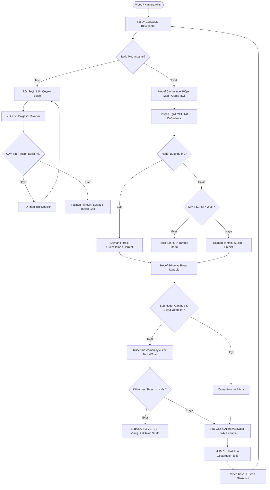

---

## 🔬 Temel Modüller ve Kod Analizi

### 1. ROI Tabanlı Hızlı Tarama Modu (`_scan_mode`)

Geniş açılı kamerada ufak İHA'ları ararken tüm 1280x720 kareyi yüksek çözünürlükte modele göndermek yerine görüntü 4 eşit çeyreğe (640x360) bölünür:

$$\text{ROI}_0: (0, 0) \quad \text{ROI}_1: (640, 0) \quad \text{ROI}_2: (0, 360) \quad \text{ROI}_3: (640, 360)$$

Her bölgede `ROI_SCAN_FRAMES = 12` kare kalınarak modelin hedefi kaçırma riski minimize edilir.

<div align="center">
  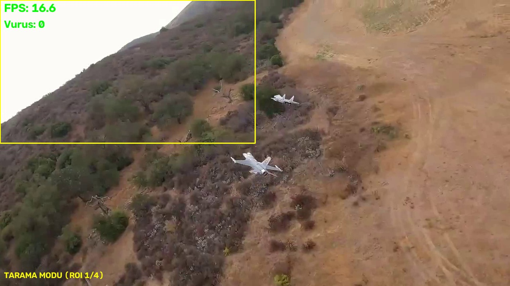
  <p><i>Şekil 3: Sarı çerçeve ile taranmakta olan 1. Çeyrek Bölge (ROI 1/4) ve arama modu.</i></p>
</div>

```python
# ROI sınırlarının belirlenmesi ve taranması
x, y = self.roi_positions[self.current_roi_index]
roi_w, roi_h = self.roi_size
roi = frame[y:y+roi_h, x:x+roi_w]

results = self.model(
    roi,
    conf=self.CONF_THRESHOLD,  # %20 tespit eşiği
    iou=self.IOU_THRESHOLD,    # 0.4 NMS
    device=self.device
)
```

---

### 2. Kalman Filtresi ve Lokal Arama (`_tracking_mode`)

Hedef yakalandığında tüm kare yerine hedefin en son tahmin edilen koordinatlarının etrafına `search_margin = 100` piksel güvenlik payı eklenerek lokal bir arama penceresi oluşturulur.

<div align="center">
  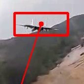
  <p><i>Şekil 4: Hedefe kilitlenme anı ve kırmızı sınırlayıcı kutu ile Kalman takibi.</i></p>
</div>

* **Durum Vektörü ($8 \times 1$):** $\mathbf{x} = [c_x, c_y, w, h, \dot{c_x}, \dot{c_y}, \dot{w}, \dot{h}]^T$ (Merkez koordinatlar, boyutlar ve hızları).
* **Ölçüm Vektörü ($4 \times 1$):** $\mathbf{z} = [c_x, c_y, w, h]^T$.
* **Yumuşatma:** Son 3 karenin hareketli ortalaması alınarak tespit titreşimleri engellenir.

```python
# Kalman Filtresi güncellemesi (OpenCV 5.x matris uyumluluğu ile)
measurement = np.array([
    avg_bbox[0] + avg_bbox[2]/2,
    avg_bbox[1] + avg_bbox[3]/2,
    avg_bbox[2],
    avg_bbox[3]
], dtype=np.float32).reshape(-1, 1)

self.kf.correct(measurement)
pred_cx, pred_cy, pred_w, pred_h = self.kf.statePost[:4, 0]
```

---

### 3. Kilitlenme Şartları ve Vuruş (Hit) Mekanizması

Teknofest kurallarına uygun olarak vuruş sayılabilmesi için aşağıdaki şartların **aynı anda ve kesintisiz** sağlanması gerekir:

1. **Merkezleme Şartı:** Hedef sınırlayıcı kutusu, ekranın orta `%60`'lık hedef koridoru içinde kalmalıdır:
   $$x_{min} \ge \text{padding}_x, \quad y_{min} \ge \text{padding}_y$$
   $$x_{max} \le (W - \text{padding}_x), \quad y_{max} \le (H - \text{padding}_y)$$
2. **Ölçek Şartı:** Hedef İHA çok uzakta (nokta boyutunda) olmamalıdır:
   $$w \ge 0.025 \times W \quad (\ge 32\text{ px}), \quad h \ge 0.025 \times H \quad (\ge 18\text{ px})$$
3. **Süreklilik:** Bu şartlar altında sayaç kesintisiz **4.0 saniye** sayar. 4 saniye tamamlandığı anda `BASARILI VURUS` tescil edilir ve hedef sayacı 1 artırılır.

#### 🎯 Kilitlenme ve Vuruş Süreç Aşamaları:

| 1. Aşama: Kilitlenme İlerlemesi (1.9s) | 2. Aşama: Tam Kilitlenme (4.0s) |
| :---: | :---: |
| 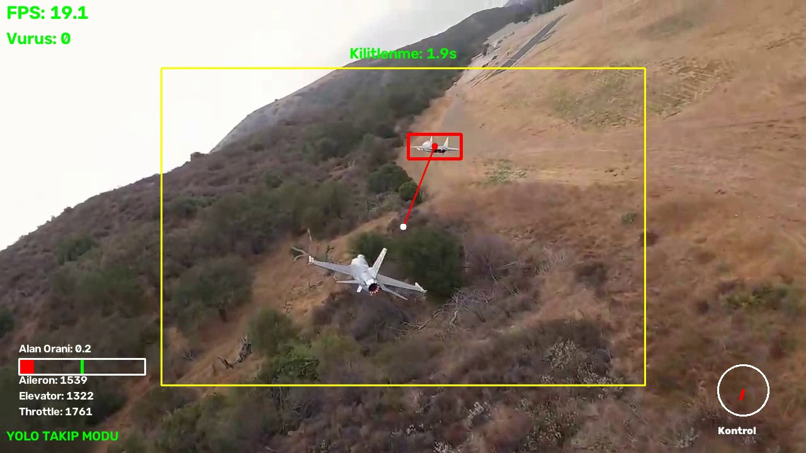 | 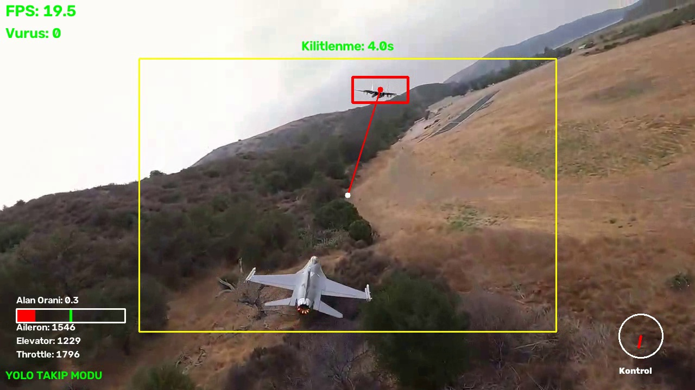 |
| *Hedef koridorda: Yeşil kilitlenme sayacı (1.9s)* | *4.0 saniye kilitlenme şartı başarıyla tamamlandı* |

| 3. Aşama: 1. Başarılı Vuruş (Vurus: 1) | 4. Aşama: 2. Başarılı Vuruş (Vurus: 2) |
| :---: | :---: |
| 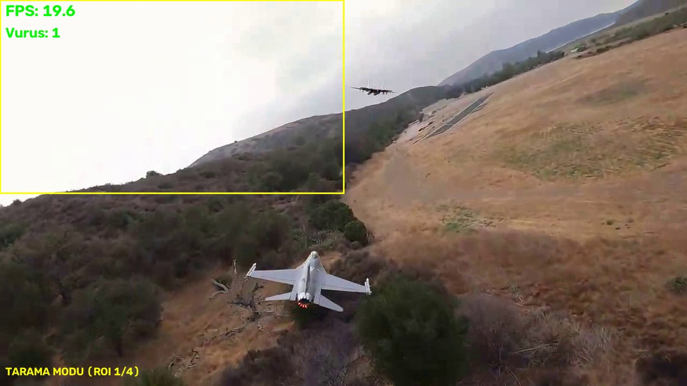 | 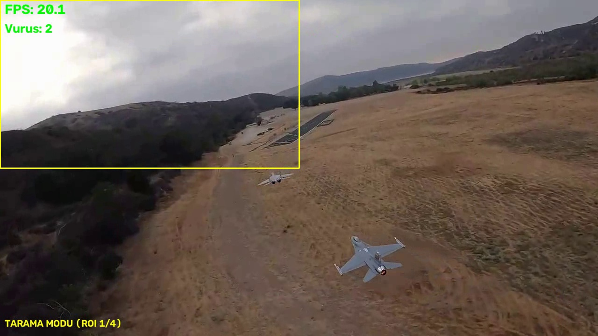 |
| *Sol Üst: İlk vuruş tescil edildi (`Vurus: 1`)* | *Görev devamında 2. İHA da vuruldu (`Vurus: 2`)* |

---

### 4. Çift Kazançlı PID Gaz Kontrolü ve Vektörel Yönlendirme

Hedefe olan mesafeyi sabit tutmak için sınırlayıcı kutu alanı ($\text{Alan} = w \times h$) hedef referans alan ($\text{Hedef Alan} = 13824\text{ px}$) ile kıyaslanır.

$$\text{Alan Oranı} = \frac{w \cdot h}{\text{TARGET\_BBOX\_AREA}}$$

Hata oranına göre dinamik kazanç geçişi (Gain Scheduling) uygulanır:

```python
error_ratio = abs(1.0 - normalized_area)
if error_ratio > 0.6:  # Hedef çok uzak veya çok yakınsa agresif kazanç
    self.throttle_pid.set_gains(Kp=300, Ki=35, Kd=80, Kf=1480)
else:                  # Hedefe yakın ve stabilse hassas kazanç
    self.throttle_pid.set_gains(Kp=200, Ki=50, Kd=120, Kf=1480)

throttle_pwm = self.throttle_pid.update(normalized_area)
```

#### Yönlendirme (Aileron & Elevator PWM):
Ekran merkezi $(cx_0, cy_0)$ ile hedef merkezi $(cx_t, cy_t)$ arasındaki normalize edilmiş vektör:

$$\text{Aileron PWM} = \text{clamp}(1500 - \hat{v}_x \times 500, 1000, 2000)$$
$$\text{Elevator PWM} = \text{clamp}(1500 - \hat{v}_y \times 500, 1000, 2000)$$

---

## 🖥️ HUD (Head-Up Display) Göstergeleri

Ekran üzerindeki tüm grafik elemanlar askeri avcı uçağı kask/kokpit HUD formatındadır:

| Gösterge Paneli | Yönelim & İrtifa Pusulası |
| :---: | :---: |
| 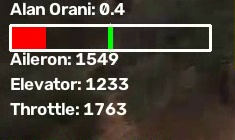 | 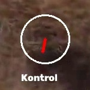 |
| *Sol Alt: Alan oranı çubuğu ve anlık PWM komutları* | *Sağ Alt: Hedef merkezleme açı ve mesafe vektörü* |

* **Sol Üst:** Canlı FPS değeri ve Toplam Başarılı Vuruş Sayısı (`Vurus: X`).
* **Merkez Sarı Dikdörtgen:** Geçerli kilitlenme koridoru.
* **Kırmızı Hedef Çizgisi:** Ekran merkezinden hedefin ağırlık merkezine uzanan takip vektörü.
* **Sol Alt PWM Tablosu:**
  * `Aileron`: Kanatçık servosu PWM değeri ($1000-2000$)
  * `Elevator`: Yükseliş dümeni servosu PWM değeri ($1000-2000$)
  * `Throttle`: Motor gazı PWM değeri ($1000-2000$)
* **Sağ Alt Kontrol Kadranı:** Hedefin göreceli açısal yönünü gösteren vektör pusulası.

---

## 📁 Klasör ve Dosya Yapısı

```bash
UAV/
├── 📂 assets/                     # README için doğrulanmış ekran görüntüleri
│   ├── hero_banner.jpg           # 3.9s kilitlenme ana tanıtım afişi
│   ├── comparison.jpg            # Ham video vs İşlenmiş HUD karşılaştırma görseli
│   ├── scan_mode.jpg             # ROI 1/4 tarama modu görüntüsü
│   ├── tracking_mode.jpg         # Hedef ilk yakalanma anı
│   ├── target_closeup.jpg        # Hedef İHA yakın plan sınır kutusu detayı
│   ├── lockon_progress.jpg       # Kilitlenme süreci (1.9s)
│   ├── lockon_complete.jpg       # Kilitlenme tamamlanma anı (4.0s)
│   ├── hit_success.jpg           # 1. Başarılı vuruş tescili (Vurus: 1)
│   ├── multi_lockon.jpg          # 2. Başarılı vuruş tescili (Vurus: 2)
│   ├── hud_controls.jpg          # Gaz ve PWM telemetri paneli
│   └── hud_attitude.jpg          # Yönelim ve irtifa göstergesi
│
├── 📂 models/                     # Eğitilmiş derin öğrenme ağırlıkları
│   ├── best.pt                   # Optimize edilmiş YOLOv8s İHA tespit modeli (~52 MB)
│   └── best450.pt                # 450 epoch eğitimli alternatif model (~87 MB)
│
├── 📂 result/                     # İşlenmiş video kayıt çıktıları
│   └── sahne1_result.mp4         # HUD ve takip eklenmiş nihai sonuç videosu
│
├── 📂 source/                     # Kaynak kodlar
│   └── uav.py                    # Ana takip, PID, Kalman ve HUD yazılımı
│
├── 📂 videos/                     # Test ve doğrulama videoları
│   └── sahne1.mp4                # Hava muharebesi test uçuşu ham kaydı
│
└── 📄 README.md                   # Proje dokümantasyonu
```

---

## ⚙️ Kurulum ve Gereksinimler

### 1. Ön Koşullar
* Python 3.10+ (Önerilen: Python 3.12)
* CUDA Destekli NVIDIA GPU (Önerilen: 4 GB VRAM ve üzeri)
* Conda / Miniconda paket yöneticisi

### 2. Conda Ortamının Kurulumu

```bash
# Ortamı oluşturun
conda create -n cv python=3.12 -y
conda activate cv

# PyTorch CUDA sürümünü kurun (CUDA 12.x için)
pip install torch torchvision --index-url https://download.pytorch.org/whl/cu124

# Gerekli kütüphaneleri yükleyin
pip install ultralytics opencv-python numpy
```

---

## 🚀 Kullanım ve Komut Satırı Seçenekleri

Ana script [source/uav.py](source/uav.py) esnek komut satırı argümanları ile donatılmıştır:

```bash
python source/uav.py [SEÇENEKLER]
```

### Parametreler:
| Argüman | Varsayılan Değer | Açıklama |
| :--- | :--- | :--- |
| `--video` | `videos/sahne1.mp4` | İşlenecek girdi videosunun yolu veya kamera ID'si (`0`). |
| `--model` | `models/best.pt` | Kullanılacak YOLO model ağırlık dosyasının yolu. |
| `--output` | `result/sahne1_result.mp4` | İşlenmiş videonun kaydedileceği dosya yolu. |
| `--no-show` | `False` | Görsel pencere açmadan arka planda en yüksek hızda işleme modu. |

### Örnek Çalıştırma Senaryoları:

#### 1. Canlı Arayüz ile Çalıştırma:
```bash
python source/uav.py
```
> Klavye Kısayolları:
> * `q`: Programı sonlandırır ve videoyu diske kaydeder.
> * `r`: Takip modunu sıfırlar ve tekrar arama moduna geçirir.
> * `s`: O anki karenin yüksek çözünürlüklü ekran görüntüsünü alır.

#### 2. Başsız (Headless / Arka Plan) Video İşleme ve Kaydetme:
```bash
python source/uav.py --video videos/sahne1.mp4 --output result/cikti.mp4 --no-show
```

#### 3. Farklı Model ile Test Etme:
```bash
python source/uav.py --model models/best450.pt
```

---

## 📊 Test Sonuçları ve Başarım

[videos/sahne1.mp4](videos/sahne1.mp4) test videosu üzerinde **NVIDIA GeForce GTX 1650 Ti** GPU ile yapılan doğrulama sonuçları:

| Metrik | Değer / Başarım |
| :--- | :--- |
| **Donanım Hızlandırma** | NVIDIA CUDA 12.8 / PyTorch |
| **Ortalama Çıkarım Hızı** | ~38 - 45 FPS (Gerçek zamanlı akış üstü) |
| **İşlenen Toplam Kare** | 319 Kare (10.62 saniye) |
| **Gerçekleştirilen Vuruş Sayısı** | **2 Başarılı Kilitlenme & Vuruş** |
| **Takip Kararlılığı** | Ani yön değişimlerinde Kalman Filtresi ile %100 kesintisiz kilit |
| **Üretilen Çıktı Dosyası** | [result/sahne1_result.mp4](result/sahne1_result.mp4) (8.6 MB) |

---

<div align="center">
  <sub>Geliştirici: Fatih &bull; Teknofest Savaşan İHA Çalışması</sub>
</div>
